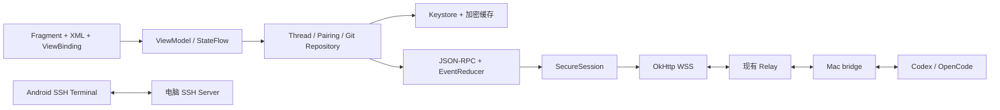

# 码舟（CodeArk）：Remodex iOS → Android 技术方案

日期：2026-10-31，已纳入用户关于完整首版、自用分发、通知接口和业务对齐的确认。代码基线：上游快照 `f67b149`；本分支已在 `7a9668c` 移除 iOS 订阅限制。本文是待实施方案，不表示 Android 客户端已经完成。

## 1. 实施结论与边界

采用 **Kotlin + 单 Activity + Fragment + XML + ViewBinding + ViewModel/StateFlow**。页面、列表项、弹层主体均在 XML 中声明，优先使用 ConstraintLayout。禁止 Compose、ComposeView、Compose UI 依赖和以网页替代主界面。允许 Kotlin 更新文字、显隐、约束状态和 RecyclerView 数据；“静态布局”指布局资源预定义，不是禁止流式内容和动画。

保留现有 Mac bridge、Codex/OpenCode 本地运行、Relay 密文转发的架构，Android 只替换 iOS 客户端。SwiftUI 不能逐文件机械转译为 XML：协议、状态机、消息合并规则移植为 Kotlin；视图依据同一交互规格重写。服务器不执行用户的 Codex、Git 或工作区命令。

交付目标为无付费墙、无消息次数上限的自托管客户端。模型服务自己的认证和额度仍由电脑上的 Codex/OpenCode 管理。扫描二维码取得 Relay 地址，不在源码中固定生产地址。首版一次性交付全部功能，包括 SSH 终端、语音、宠物、小组件和快捷方式；后台消息通知是用户明确指定的例外，仅预留接口，不实现通道。开发可以分阶段，但不能把内部阶段当作缩减首版范围的依据。

### 1.1 已确定的产品决策（2026-10-31）

| 项目 | 执行约束 |
|---|---|
| 首版范围 | 完整移植去除订阅后的 iOS 客户端功能；不采用精简 MVP，不将终端、语音、宠物或小组件延期到第二版 |
| 使用与分发 | 仅用户自己安装；交付使用固定私有签名密钥签名的 APK，支持后续覆盖升级，不做商店发布、运营账户或商业订阅 |
| 后台消息通知 | 只定义事件、通道能力、注册/注销和通知路由接口；不实现 FCM、厂商、自托管或其他具体通道，等待用户后续指定方案 |
| 业务行为 | 以去除付费限制后的 iOS 实际实现为基准，前置条件、操作时机、RPC 参数、状态变化、结果与失败恢复均需对齐 |
| UI | XML + ConstraintLayout 优先，禁止 Compose；尽量保持 iOS 的视觉与交互层级，允许系统组件替换 |
| 名称和图标 | 采用下节的“码舟（CodeArk）”及代码帆船图标方向 |

“仅自行安装”是 APK 的分发约束，不改变此前代码提交到当前 GitHub 仓库的授权。签名密钥、口令和个人配置不提交仓库；本次只确定交付方式，尚未创建 APK 签名密钥。

### 1.2 名称与图标设计

应用显示名确定为 **码舟**，英文名 **CodeArk**：手机像一艘小舟，连接电脑上的编码工作区。名称用于本次个人安装版本，不作商标独占性声明。

图标采用原创的“代码帆船”：深海蓝底 `#101C2C`，青绿色 `#55D6BE` 的简化船身与右三角帆，帆内一道白色短横象征终端光标；船身两端的斜切形成抽象代码括号。保持平面矢量、少量粗线条、不加文字、不依赖渐变或细小细节，缩小后仍能识别。

Android 实施时提供 adaptive icon 的前景/背景层、单色 themed icon 和旧版 mipmap；关键形状置于安全区域，不在素材中预先画死外框圆角。应用图标不使用上游 Remodex 标志。这里只确定设计规格，成品图标资源随 Android 工程一并交付。

## 2. 已核实的工程事实与移植位置

以下路径均相对于仓库根目录，属于本次实际阅读的实现依据。

| iOS / Node 代码 | 当前职责 | Android 对应实现 |
|---|---|---|
| `CodexMobile/CodexMobile/CodexMobileApp.swift`、`ContentView.swift` | 依赖注入、引导、配对、主界面、侧栏、前后台恢复、根弹层排队 | `MainActivity`、`RootViewModel`、`RootNavigator`，单一弹层协调器 |
| `Views/Onboarding/`、`Views/QRScannerView.swift`、`Views/QRScannerPairingValidator.swift` | 引导、相机扫码、QR 校验 | XML 引导页、CameraX PreviewView、自定义扫码遮罩、配对 ViewModel |
| `Services/CodexService+Connection.swift`、`+Transport.swift` | WebSocket、JSON-RPC、待响应请求、心跳 | `RelayConnectionManager`、`RpcClient` |
| `Services/CodexSecureTransportModels.swift`、`CodexService+SecureTransport.swift` | 身份、握手、加密信封、可信设备解析、重放 | `SecureSession`、`PairingRepository`、`TrustedDeviceStore` |
| `Services/CodexService+Incoming*.swift`、`+History.swift`、`+Sync.swift` | 增量事件、历史合并、活动状态恢复 | 纯 Kotlin `EventReducer`、`HistoryReconciler`、`ThreadRepository` |
| `Views/Turn/Core/TurnViewModel.swift`、`NewChatDraftView.swift` | 首次发送创建线程、输入草稿、队列、steer、运行控制 | `ConversationViewModel`、`ComposerState`、`PendingSendQueue` |
| `Views/Turn/Timeline/`、`Views/Turn/Messages/` | 多类型消息、工具活动、排序、滚动、渲染缓存 | 多类型 RecyclerView + `TimelineProjector` |
| `Models/CodexMessage.swift` | chat、thinking、toolActivity、fileChange、commandExecution、subagentAction、plan、userInputPrompt、autoApprovalReview、asyncUserInputAnswer | sealed message/row 类型；保留未知事件原始 JSON 供兼容 |
| `Views/Sidebar/`、`Views/SidebarView.swift` | 项目/会话分组、搜索、置顶、活动状态、设备切换 | DrawerLayout 内 XML 侧栏 + RecyclerView，平板双栏 |
| `Services/GitActionsService.swift`、`Views/Turn/Git/`、`Views/Turn/Diff/` | 分支、提交、推送、diff、工作树/撤回入口 | `GitRepository` + 分支/差异/确认弹层 |
| `Services/CodexMessagePersistence.swift`、`SecureStore.swift` | 按 Mac 隔离的加密历史、Keychain 身份 | Keystore 保护的本地加密文件与缓存索引 |
| `Services/Terminal/`、`Views/Terminal/` | 手机直连 SSH、主机密钥、终端渲染 | 独立 `SshSession` + 原生 `TerminalView`；不经过 Relay |
| `Services/CodexService+Voice.swift`、`GPTVoiceTranscriptionManager.swift` | 语音服务与转写 | 录音适配器、bridge 语音协议适配；单独验证认证链路 |
| `Models/AppFont.swift`、`Views/Turn/Composer/TurnComposerView.swift` | 字体策略、输入卡片尺寸与状态 | typography/dimens/color XML 资源、输入面板布局与状态切换 |
| `relay/relay.js`、`relay/server.js` | iphone/android 路由、单个活动移动端、可信重连 HTTP 接口 | 首期原样复用；Android 以 `x-role: android` 接入 |
| `relay/push-service.js`、`relay/apns-client.js` | 可选 APNs 推送，默认关闭 | 不能直接支持 Android 离线推送；首版仅预留可替换通道接口 |
| `phodex-bridge/src/secure-transport.js`、`relay/simulated-pairing-reconnect.test.js` | 协议另一端及配对/重连集成测试 | 互操作测试的基准实现 |

## 3. Android 架构和目录

```text
AndroidMobile/
  app/                         Activity、导航、应用级依赖装配
  core/model/                  DTO、领域模型、消息标识
  core/protocol/               RPC、事件解码、协议版本、错误映射
  core/crypto/                 身份、transcript、HKDF、AES-GCM
  core/transport/              OkHttp WebSocket/HTTP、心跳、连接代际
  core/storage/                加密缓存、可信设备、草稿、偏好
  core/ui/                     XML 样式、共用 View、图标、Markdown
  core/notification-api/       后台通知契约，无具体通道实现
  feature/pairing/              引导、扫码、手动配对、设备管理
  feature/conversation/         时间线、输入器、审批、计划、运行控制
  feature/sidebar/              项目/会话树、搜索、归档
  feature/git/                  分支、diff、提交、工作树
  feature/settings/             外观、连接、通知、运行时设置
  feature/terminal/             SSH 与终端（首版必交付）
  feature/voice/                录音、转写（首版必交付）
```

先按上述边界建包，待编译时间或团队协作需要时再拆 Gradle module，避免初期几十个空 module。`core/protocol` 和 reducer 不依赖 Android View，便于在 JVM 上做协议回归。



一个应用级连接管理器持有当前设备连接，不由每个 Fragment 单独建 WebSocket。`viewLifecycleOwner` 只收集 UI State；Fragment 销毁不等于删除设备或终止电脑任务。RPC、解密、磁盘和 Markdown 解析不占主线程，事件在有序协程队列中处理。

建议初始 `minSdk = 26`，降低旧系统加密、字体、后台兼容成本；这只是产品覆盖决策。compile/target SDK、AGP、Kotlin 和依赖版本在开工时核对最新稳定版与发布渠道要求后锁定于 version catalog，不使用动态 `+` 版本。开启 ViewBinding，关闭 Compose。ViewModel 可跨配置变化保留页面状态，但进程死亡后仍需从磁盘恢复，不把它当持久化数据库。[ViewBinding 官方说明](https://developer.android.com/topic/libraries/view-binding)、[ViewModel 官方说明](https://developer.android.com/topic/libraries/architecture/viewmodel)。

## 4. XML 页面与 iOS 视觉对应

### 4.1 页面、布局和替代组件

| iOS 界面/行为 | XML 布局主体 | 保真要求 / 原生替代 |
|---|---|---|
| 引导与功能介绍 | ConstraintLayout + ViewPager2 | 保留标题层级、图示比例、按钮位置；系统返回按 Android 语义处理 |
| 扫码页 | ConstraintLayout + PreviewView + overlay View | 顶部关闭、中央扫描框、底部手动输入；原生权限弹框 |
| 手动配对 | BottomSheetDialogFragment + XML 表单 | 必须有 Relay 地址来源；无默认地址时先填地址，再填短码 |
| 主会话 | ConstraintLayout + Toolbar 区 + RecyclerView + 输入卡片 | 保留中性背景、文本层次、圆角与操作位置 |
| 会话侧栏 | DrawerLayout + ConstraintLayout + RecyclerView | 搜索、设备、项目分组、置顶、运行标识；不能按当前仓库过滤掉其他会话 |
| 新建会话 | 主聊天布局的空态 + 项目/模型选择弹层 | 首次发送才创建线程；新工作树选项保留 |
| 用户消息 | `item_message_user.xml`，根 ConstraintLayout | 右对齐、气泡最大宽度、附件缩略图、发送状态 |
| 助手内容 | `item_message_assistant.xml` + 块渲染器 | 左对齐，尽量保留 iOS 非气泡式长文本排版 |
| thinking / 工具 / 命令 | 独立 XML item + 可折叠详情 | 保留块身份和顺序，工具条目不并成一段文本 |
| plan / subagent / 审批 | 独立 XML 卡片 + RadioGroup/按钮 | 行为先于装饰；审批选项、解释、等待状态完整显示 |
| 输入卡片 | ConstraintLayout + AppCompatEditText + 两行工具区 | 附件、模型、推理强度、权限、plan、发送/停止、队列；按钮位置与 iOS 对齐 |
| diff / 文件预览 | BottomSheetDialogFragment 或全屏 Fragment + RecyclerView | 行号、增删色、横向滚动、复制；大文件按行分页 |
| 设置 | RecyclerView 分组卡片 + SwitchMaterial 等 Views 控件 | 分组卡片样式接近 iOS；不包含订阅、恢复购买或兑换码入口 |
| 分支/模型选择 | BottomSheetDialogFragment + 单选列表 | 不照搬系统默认大面积 Material 紫色；统一项目颜色 |
| 危险 Git 操作 | MaterialAlertDialogBuilder | 保留清晰确认和服务端错误；不可把撤回与重置混为一个操作 |
| 相册/文件/分享 | Android Photo Picker、SAF、Sharesheet | 使用平台原生组件；不需要复刻 iOS 系统弹框 |
| 终端 | ConstraintLayout + 原生 TerminalView + 快捷键条 | 支持选择复制、IME、Ctrl/Esc/Tab、PTY resize，见终端章节 |
| 宠物/装饰动画 | XML 容器中的自定义 View / AnimatedImageDrawable | 首版完成交互与状态适配；不引入 Compose |
| 小组件/动态岛类状态 | RemoteViews 小组件、应用内状态条；后台通知仅接口 | 首版保留任务状态和打开会话行为；系统级浮岛改为 Android 对等呈现，不借此实现后台通知 |

ConstraintLayout 用于扁平约束布局；DrawerLayout、RecyclerView、CoordinatorLayout 属于功能容器，不为“所有根都相同”而增加无效嵌套。[ConstraintLayout 官方说明](https://developer.android.com/develop/ui/views/layout/constraint-layout)。

### 4.2 布局骨架

下面是主会话 XML 的结构示例，资源和子布局在实施时创建，尚不是可编译的 Android 工程。`view_composer.xml` 的根使用 ConstraintLayout，内部预定义附件列表、EditText、工具区、发送/停止按钮，靠状态控制显隐。

```xml
<androidx.constraintlayout.widget.ConstraintLayout
    xmlns:android="http://schemas.android.com/apk/res/android"
    xmlns:app="http://schemas.android.com/apk/res-auto"
    android:layout_width="match_parent"
    android:layout_height="match_parent"
    android:background="?attr/colorSurface">

    <androidx.appcompat.widget.Toolbar
        android:id="@+id/toolbar"
        android:layout_width="0dp"
        android:layout_height="wrap_content"
        android:minHeight="56dp"
        app:layout_constraintTop_toTopOf="parent"
        app:layout_constraintStart_toStartOf="parent"
        app:layout_constraintEnd_toEndOf="parent" />

    <androidx.recyclerview.widget.RecyclerView
        android:id="@+id/timeline"
        android:layout_width="0dp"
        android:layout_height="0dp"
        android:clipToPadding="false"
        android:paddingHorizontal="16dp"
        app:layout_constraintTop_toBottomOf="@id/toolbar"
        app:layout_constraintBottom_toTopOf="@id/composer"
        app:layout_constraintStart_toStartOf="parent"
        app:layout_constraintEnd_toEndOf="parent" />

    <include
        android:id="@+id/composer"
        layout="@layout/view_composer"
        android:layout_width="0dp"
        android:layout_height="wrap_content"
        app:layout_constraintBottom_toBottomOf="parent"
        app:layout_constraintStart_toStartOf="parent"
        app:layout_constraintEnd_toEndOf="parent" />
</androidx.constraintlayout.widget.ConstraintLayout>
```

系统栏和 IME inset 在根统一消费，随键盘动画移动 composer，避免同时设置多层 padding 导致双倍空白。timeline 不嵌套纵向 ScrollView。手机抽屉，较宽窗口采用双栏 XML 资源或预定义 ConstraintSet；折叠屏按窗口有效宽度切换，保留选中线程与滚动锚点。

### 4.3 UI 一致性标准

以同一线程数据、相同语言、等效可用宽度制作 iOS/Android 基准截图。当前分析基于源码，没有声称已完成 iPhone 截图验收；实施第一阶段必须补齐基准图。

- 从 `AppFont.swift`、具体 View 中提取字体、行高、间距和颜色，建立 `dimens.xml`、`styles.xml`、`values-night/colors.xml`。源码中 composer 外层横距 12pt、展开圆角 26pt，可作为 Android 12dp/26dp 的初值，最终依据等效宽度截图微调。
- 系统字体使用 Android 系统字体；自带 Geist/JetBrains Mono 等字体先核实随附授权再复用。不能直接把 SF 字体或 SF Symbols 当 Android 资源打包；图标用允许分发的矢量资源或重绘。
- 不启用动态取色改变产品配色。主内容层级、消息左右位置、卡片圆角、工具排列与 iOS 对齐；权限、选择器、返回手势、触觉反馈可使用原生行为。
- 视觉验收覆盖亮/暗色、中文/英文、空态/运行中/错误/离线、字体缩放 1.0/1.3/2.0。图标可以较小，实际触控区域保持至少 48dp。
- 初始视觉验收目标：关键元素边界在参考缩放后偏差不超过 4dp；字重、换行和系统字体差异人工审查，不把整屏像素完全相同作为目标。

## 5. 协议兼容：最高优先级

### 5.1 配对与路由

QR 字段保持 `v / relay / sessionId / macDeviceId / macIdentityPublicKey / expiresAt / displayName`，当前 QR 与 secure protocol 版本均为 **2**。过期时间按现有毫秒语义处理；拒绝不支持版本、非法 URL、无效身份 key 和过期 payload。二维码由应用内部扫描，不依赖相机把 JSON 当链接打开。

Android WebSocket 使用 `/relay/{sessionId}` 和 `x-role: android`。同一房间只保留一个活动移动端，新移动端接入会替换旧移动端；不能承诺 iPhone 与 Android 同时操作同一会话。bridge 的可信手机模型也应按当前单个活动配对语义验证，多设备并发是另一个协议需求。

公共地址可能含 `/remodex` 等前缀：例如 `wss://host/prefix/relay` 对应 `https://host/prefix/v1/trusted/session/resolve`。统一 URL Builder，不能硬拼根域名，也不能把 sessionId 误当作 HTTP API 路径。保留 iOS 当前的候选路径兼容行为。

短码接口为 `POST /v1/pairing/code/resolve`；短码只接受现有允许字符集 `ABCDEFGHJKLMNPQRSTUVWXYZ23456789`，可规范化空格/连字符。短码不能推导 Relay 地址，必须使用用户配置或已信任记录中的地址。

### 5.2 加密互操作细节

**WebSocket role 与 E2EE sender 是两层不同字段。** `relay/relay.js` 接受 `android`，但是 `phodex-bridge/src/secure-transport.js` 当前校验加密信封 `sender === "iphone"`。Android 首期必须保留加密层的 `iphone`、`phoneDeviceId`、`phoneToMac`、`macToPhone` 命名，不替换为 android；否则握手可能成功但应用消息被拒绝。若将来改名，需要单独协议升级与双端兼容。

握手顺序：`clientHello → serverHello → clientAuth → secureReady → resumeState → encryptedEnvelope`。实现必须逐字节复现以下内容：

1. Ed25519 长期身份签名、X25519 临时密钥交换；不要把 Ed25519 身份 key 当 X25519 key。
2. transcript 使用 **4 字节大端长度前缀 + 原始字段字节**，字段顺序与 Swift/Node 完全一致，不用 JSON 序列化结果代替。公钥字段先 Base64 解码；整数按源实现的十进制字符串参与 transcript。
3. 握手域标签保持 `remodex-e2ee-v1`，client auth 再追加 `client-auth`；协议数字是 2，不因标签中包含 v1 就擅自修改。
4. SHA-256 transcript 摘要作为派生 salt，HKDF-SHA256 的 info 保留 session/device/keyEpoch 与 `phoneToMac`、`macToPhone` 方向后缀。
5. AES-256-GCM 信封的 ciphertext/tag 分开 Base64 编码。nonce 为 12 字节，首字节为方向（mac=1，移动端=2），其余字节按现有实现编码 counter；重新握手派生新 key 后才能安全重置计数器。
6. 校验 mac 身份签名、sessionId、keyEpoch、sender、递增 counter；拒绝重复/旧包，不把解密失败降级成明文。数字使用 Long 并限制到对端 JavaScript 可安全表示范围，达到上限时重新建会话。
7. `lastAppliedBridgeOutboundSeq` 是应用回放进度，不能与加密 counter 混用。结合 `bridgeReplayEpoch` 处理电脑进程重启后的序号重置；只有应用事件成功合入后才推进 watermark。
8. trusted resolve 请求的 `nonce / timestamp / signature` 使用独立签名 transcript，成功响应必须再次检查 macDeviceId 和 identity key 与本地信任记录相符。

建议将 Bouncy Castle lightweight API 作为 Ed25519/X25519/HKDF 的首个验证候选，避免替换系统全局加密 Provider；Android JCA 处理 AES-GCM。正式锁版本前在 minSdk 真机和 JVM 上验证原始 key 编码、算法可用性、包体积和依赖冲突。自定义的是协议字节拼装，不自己实现密码算法。[Bouncy Castle 官方文档](https://www.bouncycastle.org/documentation/documentation-java/)。

### 5.3 连接状态与 JSON-RPC

连接状态至少区分 `NotPaired / TrustedMac / Resolving / Handshaking / Connected / Reconnecting / RePairRequired / UpdateRequired`。传输建立不等于 secureReady，也不等于 runtime 初始化完成；仅在对应阶段允许发送。

为每次连接分配 generation。断线后旧 socket 回调、旧请求结果不能写入新设备状态。维护 requestId→等待者表、超时、取消和 server request 回复；未知事件保留可诊断信息且不能使事件循环崩溃。传输帧设置有界大小，参照 iOS 当前 16MiB 上限处理图片较多的历史，超限给明确错误。

Wi-Fi/蜂窝切换、锁屏恢复后先探测连接、解析可信会话、重新握手，再恢复线程历史/运行态；不因暂时网络失败删除配对。连接失败做指数退避和抖动，用户主动扫码或切设备优先于自动重连。关闭码按服务器定义映射，包括 4001 旧 Mac 被替换、4002 Mac 不可用、4003 移动端被替换；其余专用码从现有测试提取，不统一当作重新扫码。

## 6. 时间线与发送行为

### 6.1 消息模型与 reducer

保留 `macDeviceId + threadId + turnId + itemId/sourceItemKey + role + kind` 的作用域，UI row 再附加 block 标识。不能只按 turnId 去重：同一 turn 内可能同时有多个助手 item、工具、推理和计划。UI stable ID 使用受控映射或完整键比较，不能仅依靠可能碰撞的字符串 hashCode。

实时增量与 `thread/read` 历史通过同一个 reducer 合并：已显示的助手消息不重复，晚到的 reasoning 追加回原块，历史回填不把执行中状态覆盖为完成。turn/started 没有 turnId 时保留线程级 running；点击停止时先从 thread/read 找 active turn，再发 interrupt。后台返回恢复 running 后，停止按钮仍必须可用。只保留当前活跃 turn 的无归属增量，避免旧事件新建假的“思考中”。

### 6.2 渲染与滚动

RecyclerView 多类型 holder 承载 XML item，稳定数据通过 DiffUtil 更新，流式 item 使用 payload 局部更新；避免每个 token 都提交整张列表。建议先以 32–50ms 合并 UI 刷新，在实际设备上测量再调整。已完成的 Markdown block 缓存，只重解析当前末尾未完成块。[RecyclerView 官方说明](https://developer.android.com/develop/ui/views/layout/recyclerview)。

Markdown 可先验证 Markwon + TextView/Spannable 路线，代码块、表格、diff 拆成独立 XML item，避免单个巨大 TextView。Markwon 能直接输出 Android 原生 Spannable；本项目仍需单独实现流式半截 Markdown、引用、复制和消息块身份，不能把 Swift 文本引擎的行为当作自动具备。[Markwon 官方说明](https://noties.io/Markwon/)。

用户接近底部时跟随新输出；主动上滑后固定可见 item + offset，不被新 token 拉回底部，展示“回到底部”。向上加载历史保持锚点。代码选择、链接点击、横向代码滚动和纵向列表手势分别处理。图片先读尺寸再限采样解码，磁盘/内存缓存均有上限。

### 6.3 发送与交互契约

- 新建线程首次发送才创建真实会话；保留 cwd、runtime provider、OpenCode model/variant、worktree 创建条件。
- 在连接、非空消息、附件准备完成、review 内容不冲突的前提下发送；不加入订阅状态或免费计数判断。
- 正在运行时区分 steer 与待发送队列；失败时恢复草稿，重连不自动重复提交不确定是否成功的请求。
- 模型、推理强度、fast/plan、权限模式、技能/插件/文件 mention 使用 bridge 能力与当前线程运行时决定选项；不能硬编码所有模型支持同一参数。
- 审批和结构化问题使用独立 requestId，只回复一次；等待服务端确认后更新 UI。默认保持 On-Request，Full access 的语义与 iOS 一致。
- Git/workspace 命令留在 Mac；Android 展示 diff、确认与结果。跨项目会话打开时自动切换本地上下文，不删除其他项目会话。

## 7. 存储、系统能力与平台差异

### 7.1 本地数据

持久化按 macDeviceId 隔离，线程索引再以 threadId 划分。历史、草稿、附件和终端私钥使用本地加密，写入采用临时文件+原子替换；纯外观偏好可用 DataStore。需要复杂分页查询时引入 Room，但 Room 本身不会自动加密：敏感列/正文必须采用经过验证的加密存储策略，不能把明文聊天或草稿放入普通数据库。

使用 Android Keystore 保存不可导出的 AES 包装密钥，保护软件生成的 Ed25519 身份、SSH 私钥及历史加密 key。不能假设所有设备 Keystore 都原生支持本协议的两种 Curve25519 密钥。信任记录、密钥材料和加密缓存排除云备份；系统清除密钥或重装后明确要求重新配对，不尝试无验证恢复旧身份。[Android Keystore 官方说明](https://developer.android.com/privacy-and-security/keystore)。

### 7.2 扫码、附件与语音

CameraX PreviewView 承载相机，选用不依赖 Google Play 服务的本地二维码解码器进行概念验证，避免国内设备无法扫码。扫描成功后暂停分析器，防止多次触发配对。照片和文件采用系统选择器，持久 URI 权限、上传失败重试和图片压缩由 attachment repository 统一处理。[CameraX 官方说明](https://developer.android.com/media/camera/camerax)。

语音分为录音采集、转写和语音会话三层。首先移植目前 bridge 可用的语音 RPC；原有 GPT 登录/回调及 iOS 特有音频会话不能直接复制，必须核对当前启用路径。设备无相应账户或服务能力时显示不可用原因。不要把系统语音识别静默替换为项目原有转写服务；如作为备用入口，应明确标识。

### 7.3 后台与通知：接口保留，通道不实现

Android 后台执行限制决定不能承诺应用退到后台后 WebSocket 永远存活。前台实时连接，后台保存进度，回前台恢复并回放；正在运行的 Codex 留在电脑继续执行。该连接恢复能力属于首版必需功能，不属于被排除的通知通道。[Android 后台限制说明](https://developer.android.com/develop/background-work/background-tasks/bg-work-restrictions)。

用户将来会指定特殊消息通知方案，首版不选择或接入任何通知供应商，不实现后台通知发送、远端设备注册或推送接收服务，不增加通知专用后台保活/轮询。本次 Relay 继续保持 push 关闭；现有 APNs 代码不改造成 Android 推送服务。应用内任务完成、需要审批等提示仍按 iOS 行为实现。

预留以下纯接口和数据契约，独立于 FCM token、APNs token 和厂商 SDK：

| 契约 | 职责与约束 |
|---|---|
| `TaskNotificationEvent` | `eventId / type / macDeviceId / threadId / turnId? / occurredAt`；类型覆盖任务完成、失败、需要审批/输入；不包含聊天正文、私钥或配对凭证 |
| `NotificationChannelPort` | 声明通道能力查询、绑定与解绑、接入事件的方法；实现由后续方案注入，不能让聊天 repository 直接依赖通道 SDK |
| `NotificationBinding` | 以通道类型、设备作用域和不透明引用描述绑定；避免把协议固定为某家 push token，敏感注册凭证不进入普通日志 |
| `NotificationOpenRequest` / `NotificationRouter` | 规范事件去重、目标设备/线程定位、等待连接恢复后打开会话的契约；跳转前沿用已有可信设备校验，不从通知建立新信任 |
| `NotificationCapability` | 明确表示 `NotIntegrated`、可用或暂不可用；未集成时不能显示“已开启/已注册/已发送成功” |

首版只保留上述边界、应用内领域事件以及与现有会话导航的接入位置，不提供生产通道实现。无通道注入时消费方应明确识别 NotIntegrated，不发网络请求、不申请通知专用权限；测试替身仅用于契约测试，不随生产包冒充真实通道。前台业务处理不能因没有通知通道失败、卡住或重复发请求。

桌面快捷方式、小组件和分享入口仍在首版实现。小组件显示已同步的任务状态并打开对应会话；后台新事件的到达依赖未来通知方案，不能宣称具备尚未实现的离线通知或持续刷新。不能用 WorkManager 常驻 socket 或定时保活来替代被排除的通知通道。

### 7.4 SSH 终端

当前终端是手机直接 SSH 电脑，和 Relay 聊天是两条链路。配置页保留 host/port/user/private key/passphrase；首次连接展示 host key 指纹，变更时阻止并要求重新确认，不能接受所有 host key。

SSH 传输可用 Apache MINA SSHD 作为 PoC 候选，但其 Java 支持不等于已证明 Android 兼容，需在 minSdk、R8 release、密钥格式和 PTY 交互下验证。终端渲染需要支持 VT/ANSI、宽字符、颜色、alternate screen、鼠标/选择、IME 与窗口 resize；不能用普通滚动 TextView 冒充完整终端。[Apache MINA SSHD 官方说明](https://mina.apache.org/sshd-project/)。

iOS 的 GhosttyKit xcframework 不能直接链接到 Android。阶段 0 对可再分发的原生终端引擎做许可与 Android NDK 构建 PoC，产出 ADR 后锁定；若候选引擎不可用，继续更换或适配引擎并重估整体工期；终端仍是首版交付门槛，不能以隐藏入口或后续补齐视为完成。终端自定义 View 放在 XML 中，不使用 Compose 或 WebView 代替全应用。

## 8. 首版完整交付与内部实施顺序

下面仅规定开发顺序，不代表多个版本或可删减范围。首个正式交付 APK 必须完成全部阶段，唯一功能例外是后台通知通道仅保留接口。内部调试包用于检查进展，不能标记为“首版完成”。

| 内部阶段 | 必须产出的内容 | 完成条件 |
|---|---|---|
| 0：全量盘点与基线 | iOS 全部可达业务入口清单、状态/RPC 对照、关键截图、Node/Kotlin golden vectors、终端/crypto ADR | 逐项记录来源与验收用例；冻结作为对齐依据的 iOS commit |
| 1：连接和聊天闭环 | XML 工程、扫码/短码、可信重连、会话列表、流式聊天、停止/草稿/错误恢复 | 协议互通、切网恢复、进程重启、无付费上限等用例通过 |
| 2：完整编码工作流 | 工具时间线、审批、plan/subagents、队列/steer、附件、Git/diff/worktree、设置、多设备切换；其他盘点出的现有业务入口 | 每个入口的输入条件、请求语义、状态和结果与 iOS 一致 |
| 3：完整平台能力 | SSH 终端、语音、宠物、小组件、快捷方式、分享、应用内提醒；后台通知接口 | 所有首版功能实机可用；通知通道无实现且不会产生虚假成功状态 |
| 4：统一验收与个人安装 | 业务差异清零、视觉/性能检查、码舟图标资源、签名 release APK、覆盖升级验证 | 全量对齐清单关闭，用户可安装与升级，签名材料保持私有 |

原方案的 9–15 工程人周仅是盘点前的粗估，不能用来缩减本次确定的完整范围。阶段 0 后依据全部功能和终端适配结果重估工期；外部依赖造成阻碍时明确记录，不能把未完成项标为“已隐藏，因此已完成”。不包含应用商店发布或后台通知通道开发。

### 8.1 业务行为对齐是硬性验收要求

对齐对象是**本仓库已经去除付费限制后的 iOS 实际业务行为**，不是只对照 README 功能列表或页面截图。阶段 0 固定具体 commit；实施中若 iOS 更新，先检查差异再决定基线升级，避免两端边做边漂移。

每个业务入口建立可追踪条目：`功能 → iOS 源码/方法 → 前置状态 → 用户动作 → RPC 方法/参数 → 状态变化 → 成功/失败/取消结果 → Android 实现 → 验收证据`。不要求 Swift/Kotlin 的代码结构一致；要求相同输入和服务端事件得到等价业务结果。平台生命周期和系统控件允许适配，但不允许自行删减操作、改变权限或调整执行语义。

| 行为域 | 必须对齐的内容与关键反例 |
|---|---|
| 配对/设备切换 | QR/短码校验、信任保存、重连优先级、密钥变化处理；不能临时断网就清除信任或串用其他设备历史 |
| 会话管理 | 新建、打开、命名、搜索、置顶、归档/恢复、分叉、项目/工作树路由；不能只保留聊天列表而省略管理动作 |
| 消息发送 | 首次发送创建线程、附件与 mention 校验、权限/模型参数、失败草稿恢复；不能用另一种 RPC 获得“看起来相同”的结果 |
| 执行控制 | 运行态、缺失 turnId 的停止回退、steer、队列暂停/恢复/取消、流失败续接；不能把继续误做成创建新线程或重复发送 |
| 时间线与历史 | item 粒度合并、晚到推理、工具/计划/子代理、审批/输入状态、回放去重、分页锚点；不能压平消息或错序 |
| 运行时能力 | Codex/OpenCode、模型/variant、推理强度、fast/plan、技能/插件、目标及其他现有控制；按服务端能力展示，不能凭 UI 写死参数 |
| 审批与输入 | On-Request/Full access、自动审批审查、结构化问题、允许/拒绝/取消/超时；不能因 Android 原生弹框不同而改变授权范围 |
| Git/工作区 | diff、提交/推送/拉取、分支/工作树、stash/reset、预览/应用撤回、桌面 handoff 等现有动作；执行地点、确认与错误处理一致 |
| SSH/语音 | 连接配置、主机指纹、PTY/快捷键/复制、录音取消/失败/重试、转写与会话结果；不以简化终端或不同转写服务替代 |
| 偏好与扩展 | 设置项、草稿/历史持久化、宠物、快捷方式、小组件的动作与状态；平台呈现可替换，业务意图和作用对象不变 |
| 通知例外 | 应用内提示与返回后恢复对齐；后台消息通知通道不实现，只有契约，不伪装在线/已投递 |

该表是验收分类，不是对未盘点代码的功能完整性声明。所有源码盘点发现的可达业务均补入清单，不能因为未出现在表中就排除。已关闭的实验分支/不可达旧代码单独标明，不作为活跃功能实现。

默认差异仅限：用户要求的无付费限制、后台通知接口化、个人安装和新品牌，以及已经明确允许的 Android 原生系统呈现。若发现 iOS 行为疑似缺陷或平台无法等价实现，说明具体差异和影响后由用户决定是否接受；不能自行“优化”成另一套业务规则。

## 9. 测试矩阵与发布门槛

协议测试首先覆盖 Node↔Kotlin 的 transcript、签名、KDF、双向密文、错误 tag、过期 QR、nonce 重放、旧 keyEpoch、重复 counter、bridge 进程重启、replay buffer 截断与 watermark 恢复。复用现有 `phodex-bridge/test/secure-transport.test.js`、`relay/simulated-pairing-reconnect.test.js` 的场景，不能只测 Android 自己加密再自己解密。

reducer 固定录制脱敏事件序列：缺失 turnId、多个 assistant item、晚到 reasoning、历史与流同时到达、用户输入审批、subagent、断线恢复与 stop。验证最终状态和消息数量/顺序，而不是测试某个实现方法被调用几次。

UI 使用 XML View 的 Espresso/截图测试，至少覆盖手机小屏、常见大屏、平板/折叠窗口；真机覆盖最低支持版本、当前稳定版，以及至少一种无 Google Play 服务的国内设备。验证中文 IME、多行输入、输入中旋转、权限拒绝、暗色、字体缩放、TalkBack、后台进程被杀。

性能目标作为验收预算而非现成测量结果：普通聊天滚动主线程大部分帧在 16.7ms 内；1,000 条混合消息不一次 inflate 全部 item；长代码/图片历史不触发 OOM；连续流式输出 30 分钟无持续内存增长。通过 Macrobenchmark/Perfetto 与实际低端设备确定最终阈值。

发布门槛：无 Compose 依赖；主页面/列表项有 XML 资源；协议与 reducer 测试通过；release R8 包安装可运行；公网 WSS 实机配对成功；关键截图人工签收；许可证清单完整。应用名称及图标按“码舟（CodeArk）”规格交付；全量业务对齐清单逐项验收，包括 SSH、语音、宠物和小组件，不接受占位入口。通知接口契约测试验证未接入状态、事件作用域、无通道副作用与路由数据约束；不要求被明确排除的后台投递功能通过。个人安装还需验证固定签名 APK 覆盖升级后的配对、历史和配置保留。

## 10. 本次工作与后续实施的分界

本次已经完成 iOS 订阅代码清理，并沿用现有 Relay 服务器代码部署；不修改其 E2EE 或执行权限语义。Android 工程、APK、截图基线和真机验收属于下一次开发交付。

实施时默认创建独立工作树；如要把修改后的 bridge/relay 发送到远端机器验证，先合入主分支，再从该提交打包部署。生产地址、证书、私钥和本次部署操作记录保留在私有配置/工作区，不写进公开仓库。
